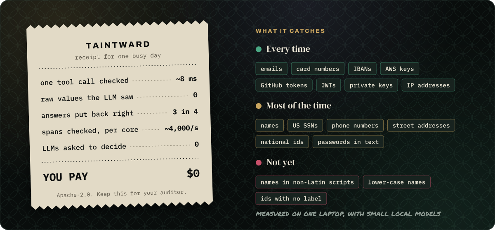

<p align="center">
  <a href="https://github.com/DCchoudhury15/Taintward/actions/workflows/ci.yml"></a>
  <a href="https://pypi.org/project/taintward/"></a>
  <a href="https://dcchoudhury15.github.io/Taintward/"></a>
  <a href="LICENSE"></a>
</p>

<p align="center">
  <a href="https://taintward.vercel.app"><b>Play with it</b></a> ·
  <a href="docs/quickstart.md"><b>Quickstart</b></a> ·
  <a href="https://dcchoudhury15.github.io/Taintward/"><b>Docs</b></a> ·
  <a href="docs/threat-model.md"><b>Threat model</b></a>
</p>

<br>

Your agent reads a customer record, asks a model about it, calls an API and
writes a log line. Somewhere in there an email address went to the LLM
provider, an SSN went to a third party, and an API key landed in your logs.
Nobody noticed.

Taintward notices. It checks every tool call and every model call, and
rewrites the private values for **where they are going**.



## The model still gets its work done

A mask breaks the agent. A model that reads `Remind [PII]` can't write the
email. So the model gets placeholders instead, and you get the real values
back in the answer.

```text
you send      Remind Alice Lee (alice.lee@example.com) that her tax form is missing.
model sees    Remind <PERSON_1> (<EMAIL_1>) that her tax form is missing.
model says    Done. I wrote to <PERSON_1> at <EMAIL_1>.
you get       Done. I wrote to Alice Lee at alice.lee@example.com.
```

The map from `<PERSON_1>` to the real name never leaves your process.

## Try it in two minutes

```bash
git clone https://github.com/DCchoudhury15/Taintward && cd Taintward
docker compose up --build
```

Open http://localhost:16686 and pick `taintward-hr-bot`. A demo HR agent
tries to leak a fake SSN and a fake cloud key to an LLM, an external API and
a log. All three calls show up flagged, and the real values are nowhere in
the traces.

## Add it to your agent

**Python**

```bash
pip install "taintward[langchain]"
python -m spacy download en_core_web_sm       # for names
```

```python
import taintward as tw

tw.init("my-agent", destinations={"search_db": "internal", "send_email": "external"})
tools = tw.wrap_langchain_tools(tools)
model = tw.protect_langchain_model(model)      # or tw.protect_openai(OpenAI())

with tw.run():
    agent.invoke(...)
```

It is the same two calls in every framework, one for the tools and one for
the model: LangChain, LangGraph, OpenAI Agents SDK, CrewAI, LlamaIndex,
Pydantic AI, Google ADK, LiteLLM, and the plain OpenAI and Anthropic
clients. [The full table](docs/integrations.md#install).

**TypeScript**

```ts
import { wrapLanguageModel } from "ai";
import { taintwardMiddleware } from "taintward/ai-sdk";

const model = wrapLanguageModel({
  model: openai("gpt-4.1"),
  middleware: taintwardMiddleware(),
});
```

Also `protectOpenAI`, `protectAnthropic` and Mastra agents.
[TypeScript SDK](packages/taintward-js/README.md).

**No code changes**

| you run | you add |
|---|---|
| MCP servers | `taintward-gateway --config gateway.yaml` in place of the real server ([gateway](docs/mcp-gateway.md)) |
| a LiteLLM proxy | `TaintwardGuardrail` as a guardrail ([how](docs/integrations.md)) |
| Kubernetes | the Helm chart: collector, gateway, key rotation ([deploy](docs/deploy-kubernetes.md)) |

## What is in the box

| part | what it does for you |
|---|---|
| **SDK** | finds private values in tool calls and model calls and rewrites them on the way out |
| **MCP gateway** | does the same in front of any MCP server |
| **Collector processor** | checks every span against a policy you can read (Rego) and scrubs what is left |
| **[Evidence report](docs/evidence-report.md)** | one page for the customer who asks "do you send our data to OpenAI?", backed by a signed log nobody can quietly edit |
| **[Compliance mapping](docs/compliance.md)** | which GDPR, EU AI Act, HIPAA and SOC 2 points the report supports, and which it does not |
| **[Audit](docs/audit.md)** | lists the paths data could take through your tools, before any of them runs |
| **[Control plane](docs/control-plane.md)** | policies, spans and reports for many tenants |
| **[Key management](docs/key-management.md)** | keys in Vault, AWS KMS or Google Cloud KMS, with rotation |

## What it costs, what it catches



How these were measured: [benchmark](docs/benchmark.md) ·
[placeholders with real models](docs/placeholders-eval.md).

## Where it stops

- It protects the calls that go through it. A client or tool you did not
  wrap is not seen.
- It does not stop prompt injection. It limits what an injected instruction
  can get out.
- A value that is encoded, split across fields or in a format it does not
  know can slip past.

Every known gap, and a checklist for production:
[threat model](docs/threat-model.md).

## Where it comes from

Taintward is built on the formal model from
[AgentRaft](https://arxiv.org/abs/2603.07557) (Lin et al., 2026), which
found data over-exposure in 57% of the agent call chains it studied.
AgentRaft runs offline and asks three LLMs to judge each step. Taintward
runs live and asks none. [How the parts map](docs/agentraft-mapping.md).

<details>
<summary><b>Development</b></summary>

```bash
python -m pytest -q                                   # Python
cd collector/processor/taintpolicy && go test ./...   # Go collector processor
cd packages/taintward-js && npm ci && npm test        # TypeScript
```

[Contributing](CONTRIBUTING.md) · [Security](SECURITY.md) · [Changelog](CHANGELOG.md)

</details>

<sub>Apache-2.0. Called AgentWard before 0.2.0.</sub>
