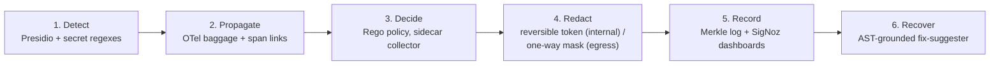
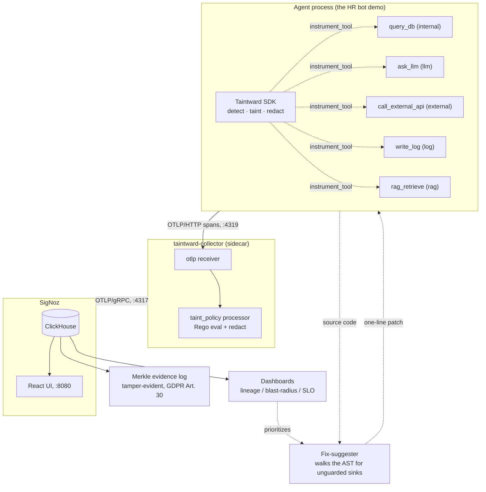

# Taintward

Taintward finds sensitive data (SSNs, emails, API keys, names) in the tool
calls of AI agents, tracks it through the call chain with OpenTelemetry
baggage, and redacts it for each destination before it leaves: internal
systems get a reversible FF1 token, the LLM gets placeholders such as
`<PERSON_1>`, and external APIs and logs get a one-way mask. Every decision
is recorded in a signed, tamper-evident evidence log. It is runtime
**enforcement** of the Data Over-Exposure (DOE) model on OpenTelemetry.

Taintward was called AgentWard before version 0.2.0.

## The problem

AI agents chain tool calls together: read from a database, hand the result to
an LLM, call an external API, write a log line. Somewhere in that chain, a
field that must stay internal (an SSN, an API key, a customer's address) can
reach an external sink, because nothing tracks where the data *goes* once it
enters the chain.

[AgentRaft](https://arxiv.org/abs/2603.07557) (Lin et al., March 2026) proved
this is measurable: it found this kind of over-exposure in 57% of the call
chains it analyzed. But AgentRaft is a research pipeline, not something you
can run in production. It works offline, on a custom trace format from the
AgentDojo benchmark, and it decides "was this data strictly necessary?" by
polling three different LLMs and taking a majority vote.

Taintward takes AgentRaft's formal model and turns it into something that
runs live, on infrastructure you already have (OpenTelemetry + SigNoz), with
no LLM in the hot path:

| AgentRaft | Taintward |
|---|---|
| Φ = LLM-judged semantic dependency (taint propagation) | structural OTel **baggage + span-link** propagation, real-time and LLM-free |
| D_nec = GPT-4.1 / Qwen3-Plus / DeepSeek-V3.2 voting committee | deterministic **Rego** policy, auditable, no 3 LLM calls per step |
| AgentDojo custom trace format | standard OTel `gen_ai.*` semconv into **SigNoz** |
| offline **detection** | runtime **enforcement** (redact-before-egress) |
| metrics | **lineage / blast-radius** as GDPR Art. 30 evidence |

The underlying math (`D_OE = (D_trans \ (D_nec ∪ D_int)) ∩ D_total`) is kept
exactly as AgentRaft defined it, see [`taintward/core/doe.py`](taintward/core/doe.py) and
[`docs/agentraft-mapping.md`](docs/agentraft-mapping.md) for the full
section-by-section mapping. The build plan is in [`PLAN.md`](PLAN.md).

## How it works

Six stages, each replacing one piece of AgentRaft with something that runs
in real time:



And here is the actual runtime shape of it, an agent process instrumented
with the Taintward SDK, talking to a sidecar collector that makes the
policy decision before anything reaches storage:



Two propagation layers do the actual tracking, which is the part that has
to survive an LLM rewriting the data beyond recognition:

1. **Chain-level (baggage)**: the moment a tool call touches sensitive data,
   a compact tag (`taint.id`, `taint.classes`, never the value itself) rides
   along in OTel baggage to every downstream span in that trace. This
   doesn't care what the LLM does to the data. Even if summarizing or
   translating destroys the original bytes, the taint tag survives because
   it's attached to the *call chain*, not the *value*.
2. **Field-level (re-detection)**: every tool's input and output is
   re-scanned on the way through, so brand-new sensitive data introduced
   mid-chain (an LLM inventing a plausible-looking SSN, say) still gets
   caught.

At the sink, the collector's Rego policy is what actually decides:
`sensitive data + destination in {external, llm, log} ⇒ violation`, plus a
second rule for cross-border transfers (`PII + non-adequate jurisdiction ⇒
transfer_violation`, the GDPR Art. 44 case). Whatever the policy flags gets
redacted before it's ever written to SigNoz's storage.

## See it in action

Running the breach simulator (injects a fake SSN and AWS key into the HR
bot's database, then lets the agent's normal `query_db → internal_store →
ask_llm → rag_retrieve → call_external_api → write_log` chain run) produces
this, verified against a live SigNoz instance:

| tool | destination | stored value | violation | transfer |
|---|---|---|---|---|
| `query_db` | internal | `"ssn": "[PII]"` | no | no |
| `internal_store` | internal | `"ssn": "103-48-0677"` (reversible token, same shape as a real SSN, round-trips to the original) | no | no |
| `ask_llm` | llm | `"ssn": "[PII]"` | **yes** | **yes** |
| `rag_retrieve` | rag | `[PII]` (embeddings are invertible, so RAG is treated as egress too) | no | no |
| `call_external_api` | external | `[PII]` | **yes** | **yes** |
| `write_log` | log | `[PII]` | **yes** | no |

The real SSN and the real AWS key never appear anywhere in ClickHouse, not
even in the spans for tools that legitimately need the data internally.
That's the "context-aware" part: the same field gets a reversible token in
one tool and an irreversible mask two hops later, because the system tracked
*where the data was actually headed*, not just what field it came from.

## Quickstart

```bash
docker compose up --build
```

This starts the Taintward collector, a demo HR agent that leaks an SSN and an
AWS key, and a Jaeger trace viewer. Open http://localhost:16686, pick the
service `taintward-hr-bot`, and you will see `ask_llm`, `call_external_api`
and `write_log` flagged as violations, with no raw SSN or key anywhere. Full
walkthrough, and how to send traces to SigNoz instead: [`docs/quickstart.md`](docs/quickstart.md).

## Use it in your agent

```bash
pip install "taintward[langchain]"      # or [openai-agents], [mcp], [llm]
python -m spacy download en_core_web_sm
```

**LangChain / LangGraph / OpenAI Agents SDK.** One `init()` call, then wrap
your tools and model (`tw.wrap_function_tools` for the OpenAI Agents SDK).
Tools not in the map are treated as `external`, so a forgotten tool gets
masked data, never raw data.

```python
import taintward as tw

tw.init("my-agent", destinations={
    "search_db": "internal",
    "send_email": ("external", "us"),   # (destination, jurisdiction)
})
tools = tw.wrap_langchain_tools(tools)       # keeps names and schemas
model = tw.protect_langchain_model(model)    # redacts every request to the LLM
with tw.run():
    agent.invoke(...)
```

Plain OpenAI and Anthropic clients:

```python
client = tw.protect_openai(OpenAI())         # or tw.protect_anthropic(Anthropic())
with tw.run():
    reply = client.chat.completions.create(model="gpt-4.1-mini", messages=messages)
```

The model sees `<PERSON_1>` and `<SSN_1>`; the reply your code gets back has
the real values again (`tw.restore` does the same for any value). Details
and limits: [`docs/integrations.md`](docs/integrations.md).

**MCP gateway, no code changes.** Put `taintward-gateway --config gateway.yaml`
in your MCP client config in place of the real server. Every tool call is
scanned and, per tool, redacted, blocked or only recorded (audit mode).
See [`docs/mcp-gateway.md`](docs/mcp-gateway.md).

**If detection cannot load.** When spaCy or Presidio fail to load, Taintward
logs one ERROR and falls back to regex-only detection (SSNs, cards, emails,
secrets are still found; names are not). `tw.health()` reports the state,
and `TAINTWARD_FAIL_CLOSED=1` refuses calls to non-internal sinks while
detection is degraded.

## Numbers

Detection quality and the time added to a tool call, from
[`docs/benchmark.md`](docs/benchmark.md) (one laptop, single thread):

| | before the fast path | 0.2.0 |
|---|---:|---:|
| wrapped tool call, 1 KB, p50 | 518 ms | **8.4 ms** |
| wrapped tool call, 1 KB, p99 | 690 ms | **11.6 ms** |
| wrapped tool call, 10 KB, p50 | 4,067 ms | **38 ms** |
| false alarms on clean payloads that look sensitive | 48% to 52% | **0%** |
| example-level recall | 0.94 | 0.94 |

Collector throughput, from [`docs/scaling.md`](docs/scaling.md):

| spans | spans/s per core |
|---|---:|
| every span is a violation (redacted) | about 4,000 |
| clean spans (policy runs, nothing to redact) | about 17,000 |

Throughput grows with cores at the same rate per core. The scaling doc also
has gateway numbers and a sizing guide.

## Documentation

| topic | doc |
|---|---|
| run the demo with Docker | [`docs/quickstart.md`](docs/quickstart.md) |
| framework adapters and settings | [`docs/integrations.md`](docs/integrations.md) |
| MCP gateway | [`docs/mcp-gateway.md`](docs/mcp-gateway.md) |
| compliance report and evidence log | [`docs/evidence-report.md`](docs/evidence-report.md) |
| Helm chart and Kubernetes | [`docs/deploy-kubernetes.md`](docs/deploy-kubernetes.md) |
| throughput and sizing | [`docs/scaling.md`](docs/scaling.md) |
| detection benchmark | [`docs/benchmark.md`](docs/benchmark.md) |
| tokens, FF1 and the vault | [`docs/redaction-crypto.md`](docs/redaction-crypto.md) |
| changes per release | [`CHANGELOG.md`](CHANGELOG.md) |

## Status

All six phases are built and verified, each landed as its own stacked PR:

| phase | does | replaces |
|---|---|---|
| 1 | formal DOE model + local SigNoz substrate | (foundation) |
| 2 | runtime taint on OTel (baggage + per-I/O re-detection) | AgentRaft's Φ (LLM-judged propagation) |
| 3 | Rego policy in a sidecar collector | AgentRaft's D_nec 3-LLM committee |
| 4 | reversible, context-aware redaction (FF1 FPE for internal, mask for egress) | static field-name masking |
| 5 | tamper-evident Merkle log + lineage / blast-radius / SLO dashboards | metrics turned into verifiable Art. 30/15 records |
| 6 | AST-grounded fix-suggester + DLP dry-run | (AgentRaft has no recovery step) |

On top of that, v0.2 adds what is needed to use it for real:

- one-command Docker quickstart ([`docs/quickstart.md`](docs/quickstart.md))
- framework adapters for LangChain, LangGraph, the OpenAI Agents SDK and the OpenAI / Anthropic clients ([`docs/integrations.md`](docs/integrations.md))
- an MCP gateway with redact / block / audit modes ([`docs/mcp-gateway.md`](docs/mcp-gateway.md))
- placeholders for the LLM (`<PERSON_1>`), restored to the real values in the reply
- FF1 encryption checked against the NIST sample vectors, and a token vault (in memory, SQLite, Postgres or Redis, encrypted at rest) with per-subject erasure for GDPR ([`docs/redaction-crypto.md`](docs/redaction-crypto.md))
- a compliance report and a sharded evidence log with Ed25519 signed checkpoints and RFC 9162 proofs ([`docs/evidence-report.md`](docs/evidence-report.md))
- a Helm chart for the collector and the gateway ([`docs/deploy-kubernetes.md`](docs/deploy-kubernetes.md)) and load tests ([`docs/scaling.md`](docs/scaling.md))
- detection about 60 times faster with no false alarms on the benchmark ([`docs/benchmark.md`](docs/benchmark.md))
- CI for GitLab and GitHub

The full list is in [`CHANGELOG.md`](CHANGELOG.md).

Per-phase writeups live in `docs/phase{3,4,5,6}-*.md` and `docs/spike-llm-hop.md`.

## Run it yourself

```bash
# unit tests, no SigNoz needed
python3 -m pytest -q                                   # Python tests
cd collector/processor/taintpolicy && go test ./...   # Go processor tests

# end-to-end against your own SigNoz
cd signoz && foundryctl cast -f casting.yaml                              # start SigNoz
cd collector && ./bin/taintward-collector --config file:./config.yaml &  # sidecar, :4319
python3 demo/hr_bot/breach_simulator.py --endpoint http://localhost:4319/v1/traces
python3 demo/phase5_evidence_demo.py                    # Merkle inclusion + tamper check
taintward-fix taintward/fix_suggester/sample_buggy_agent.py       # exits 1 when it finds unguarded sinks
```

Then open `http://localhost:8080`, filter on `taintward.violation=true`, and
you'll see the flagged spans from the run above.

**Keys.** Set `TAINTWARD_FPE_KEY` (hex AES key) for stable tokens. Without it
a random key is made per process and a warning is printed. The public demo
key is only used when `TAINTWARD_ALLOW_DEMO_KEY=1`. The FF1 code has not had
an outside audit yet; see [`docs/redaction-crypto.md`](docs/redaction-crypto.md)
for the limits.

## Layout

```
taintward/                   the Python package (import taintward as tw)
  core/                      formal DOE model (pure, the mathematical anchor)
  sdk/                       detect / taint / redact / vault / instrumentation
  sdk/integrations/          LangChain, LangGraph, OpenAI Agents, LLM client adapters
  gateway/                   MCP gateway (redact / block / audit per tool)
  evidence/                  evidence log, signed checkpoints, compliance report
  fix_suggester/             AST-walk patch proposer
collector/                   Go: custom OTel processor + Rego policy
deploy/                      Helm chart, gateway Dockerfile
demo/hr_bot/                 the instrumented demo bot + breach simulator
dashboards/                  SigNoz JSON: lineage / blast-radius / SLO / alerts
bench/, loadtest/            detection benchmark and load tests
site/                        landing page
tests/                       unit + e2e
```

## References

- AgentRaft: Automated Detection of Data Over-Exposure in LLM Agents, Lin et al.,
  arXiv:2603.07557, March 2026.
- OpenTelemetry GenAI semantic conventions (`gen_ai.*`).
- SigNoz, OTel-native observability.
