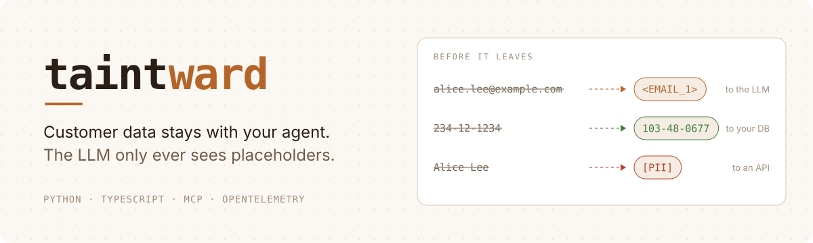
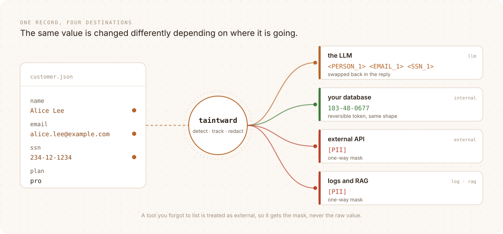
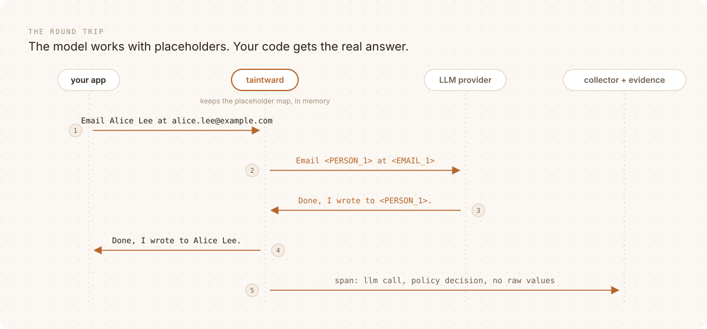
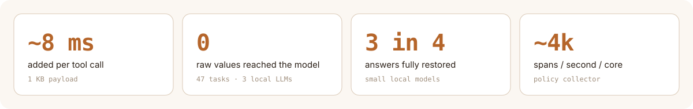
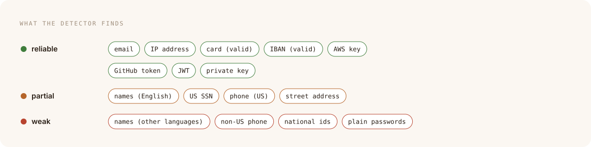
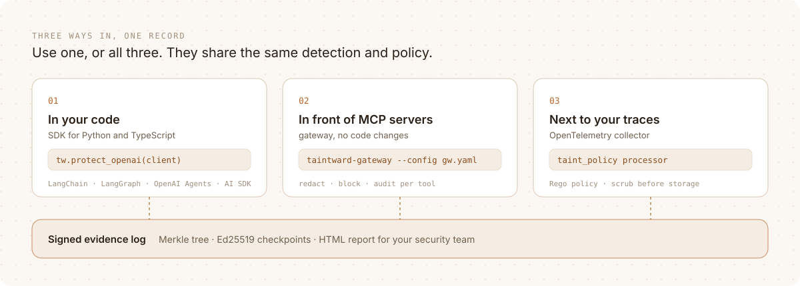

<picture>
  <source media="(prefers-color-scheme: dark)" srcset=".github/assets/hero-dark.svg">
  
</picture>

<p align="center">
  <a href="https://github.com/DCchoudhury15/Taintward/actions/workflows/ci.yml"></a>
  <a href="https://dcchoudhury15.github.io/Taintward/"></a>
  <a href="LICENSE"></a>
  
  
</p>

<p align="center">
  <a href="https://dcchoudhury15.github.io/Taintward/"><b>Docs</b></a> ·
  <a href="docs/quickstart.md"><b>Quickstart</b></a> ·
  <a href="docs/threat-model.md"><b>Threat model</b></a> ·
  <a href="https://taintward.vercel.app"><b>Website</b></a>
</p>

<br>

An agent reads a customer record, asks the model about it, calls an API and
writes a log line. Each step is fine on its own. Together they send an
email address to the LLM provider, an SSN to a third party and an API key to
your log storage, and nothing in a normal agent stack notices.

Taintward notices. It finds sensitive values in every tool call and model
call, follows them through the whole run, and changes them for **where they
are going** before they leave.

<picture>
  <source media="(prefers-color-scheme: dark)" srcset=".github/assets/journey-dark.svg">
  
</picture>

## The round trip

Masks break agents: a model that reads `Remind [PII] ([PII])` cannot write
the email. Placeholders do not. The model gets `<PERSON_1>` and `<EMAIL_1>`,
does its job, and the answer comes back with the real values in it.

<picture>
  <source media="(prefers-color-scheme: dark)" srcset=".github/assets/roundtrip-dark.svg">
  
</picture>

The same value always gets the same placeholder within a run, so the model
can still tell two people apart. If it rewrites one (`[EMAIL_1]`,
`EMAIL_1`), it is still restored. The map from placeholder to value never
leaves your process.

## In numbers

<picture>
  <source media="(prefers-color-scheme: dark)" srcset=".github/assets/stats-dark.svg">
  
</picture>

<picture>
  <source media="(prefers-color-scheme: dark)" srcset=".github/assets/coverage-dark.svg">
  
</picture>

Measured on one laptop, and on public datasets the rules were never tuned
on. How: [benchmark](docs/benchmark.md) ·
[placeholders with real models](docs/placeholders-eval.md).

## Where it runs

<picture>
  <source media="(prefers-color-scheme: dark)" srcset=".github/assets/deploy-dark.svg">
  
</picture>

## See it work

```bash
git clone https://github.com/DCchoudhury15/Taintward && cd Taintward
docker compose up --build
```

Open http://localhost:16686 and pick `taintward-hr-bot`. A demo HR agent
leaks a fake SSN and AWS key to an LLM, an external API and a log. All three
calls show up flagged, and the real values are nowhere in the traces.

## Add it to your agent

**Python** · LangChain, LangGraph, OpenAI Agents SDK, CrewAI, LlamaIndex,
Pydantic AI, Google ADK, LiteLLM, OpenAI, Anthropic

```bash
pip install "taintward[langchain] @ git+https://github.com/DCchoudhury15/Taintward"
python -m spacy download en_core_web_sm
```

```python
import taintward as tw

tw.init("my-agent", destinations={"search_db": "internal", "send_email": "external"})
tools = tw.wrap_langchain_tools(tools)
model = tw.protect_langchain_model(model)      # or tw.protect_openai(OpenAI())

with tw.run():
    agent.invoke(...)
```

Every framework gets the same two calls, one for its tools and one for its
model: `tw.wrap_crewai_tools(...)` and `tw.protect_crewai_llm(...)`,
`tw.wrap_adk_tools(...)` and `tw.protect_adk_model(...)`, and so on
([the full table](docs/integrations.md#install)).

**TypeScript** · Vercel AI SDK, `generateText` and `streamText`

```ts
import { wrapLanguageModel } from "ai";
import { taintwardMiddleware } from "taintward/ai-sdk";

const model = wrapLanguageModel({
  model: openai("gpt-4.1"),
  middleware: taintwardMiddleware(),
});
```

**MCP** · no code changes: put `taintward-gateway --config gateway.yaml` in
your MCP client config in place of the real server.

**LiteLLM proxy** · no code changes: add
`taintward.sdk.integrations.litellm.TaintwardGuardrail` as a guardrail. The
model providers get placeholders, and the apps behind the proxy still get
answers with real values.

More: [Python integrations](docs/integrations.md) ·
[TypeScript SDK](packages/taintward-js/README.md) ·
[MCP gateway](docs/mcp-gateway.md) ·
[Kubernetes](docs/deploy-kubernetes.md)

## Where it stops

- It protects the calls that go through it. A client or tool you did not
  wrap is not seen.
- It does not stop prompt injection. It limits what an injected
  instruction can get out.
- A value that is encoded, split across fields or in an unknown format can
  slip past detection.

Every known gap and a hardening checklist: [threat model](docs/threat-model.md).

## Background

Built on the formal model from
[AgentRaft](https://arxiv.org/abs/2603.07557) (Lin et al., 2026), which
found data over-exposure in 57% of the agent call chains it studied.
AgentRaft runs offline and asks three LLMs to judge each step. Taintward
runs live, with no LLM in the decision:
[how the parts map](docs/agentraft-mapping.md). It was called AgentWard
before 0.2.0.

<details>
<summary><b>Development</b></summary>

```bash
python -m pytest -q                                   # Python
cd collector/processor/taintpolicy && go test ./...   # Go collector processor
cd packages/taintward-js && npm ci && npm test        # TypeScript
```

[Contributing](CONTRIBUTING.md) · [Security](SECURITY.md) · [Changelog](CHANGELOG.md)

</details>

<sub>Apache-2.0</sub>
