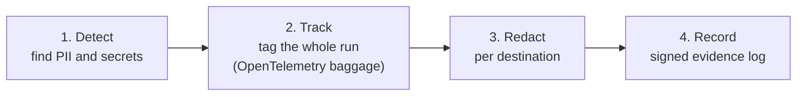

<div align="center">

# Taintward

**Let your AI agent use customer data without sending it to the LLM.**

[](https://github.com/DCchoudhury15/Taintward/actions/workflows/ci.yml)
[](https://dcchoudhury15.github.io/Taintward/)
[](LICENSE)


[Docs](https://dcchoudhury15.github.io/Taintward/) ·
[Quickstart](docs/quickstart.md) ·
[Threat model](docs/threat-model.md) ·
[Website](https://taintward.vercel.app)

</div>

---

## What it does

Taintward sits between your agent and the outside world. It finds sensitive
values (SSNs, emails, cards, API keys, names) in every tool call and model
call, and changes them based on **where they are going**:

```text
your user  : Remind Alice Lee (alice.lee@example.com) about her tax form.

to the LLM : Remind <PERSON_1> (<EMAIL_1>) about her tax form.
LLM replies: send_email(to="<EMAIL_1>", body="Hi <PERSON_1>, ...")
your code  : send_email(to="alice.lee@example.com", body="Hi Alice Lee, ...")
```

The model can still do its job, because it sees consistent placeholders
instead of blanks. The real values never leave your process.

| where the data goes | what it gets |
|---|---|
| the LLM | a placeholder like `<PERSON_1>`, swapped back in the reply |
| your own systems | a reversible token that keeps the shape (an SSN still looks like an SSN) |
| external APIs, logs, RAG | a one-way mask: `[PII]` or `[SECRET]` |
| a tool you forgot to list | treated as external, so it gets the mask |

Every decision is recorded in a signed, tamper-evident log, and
`taintward-report` turns it into an HTML report your security team can read.

## At a glance

<table>
<tr>
<td align="center" width="25%"><h3>~8 ms</h3>added to a tool call<br/><sub>1 KB payload, one laptop</sub></td>
<td align="center" width="25%"><h3>0</h3>raw values reached the model<br/><sub>47 tasks, 3 local LLMs</sub></td>
<td align="center" width="25%"><h3>3 in 4</h3>tasks fully restored<br/><sub>with small local models</sub></td>
<td align="center" width="25%"><h3>~4,000</h3>spans/s per CPU core<br/><sub>collector, all redacted</sub></td>
</tr>
</table>

**Good at:** emails, US-format SSNs, valid card numbers and IBANs, IP
addresses, and known key formats (AWS keys, GitHub tokens, JWTs, private
keys). Emails and IP addresses are found 95% of the time or more, also on
outside data.

**Weaker at:** names in non-English text, non-US phone numbers and national
ids, addresses written in parts, and plain passwords. On public datasets it did not see during
development it found something sensitive in 68% to 93% of the examples that
had some. Full numbers: [benchmark](docs/benchmark.md) and
[placeholder evaluation](docs/placeholders-eval.md).

## How it works



1. **Detect.** Patterns with checksums (cards, IBANs, SSNs), secret formats,
   and a small NER model for names.
2. **Track.** Once a call touches sensitive data, the whole run is tagged.
   The tag survives even when the LLM rewrites the data.
3. **Redact.** Before anything leaves, values are replaced for that
   destination. A Rego policy decides what counts as a violation.
4. **Record.** Violations go into an append-only Merkle log with signed
   checkpoints, and anything raw left in a trace is removed before storage.

## Try it

Needs Docker. The first build takes a few minutes.

```bash
git clone https://github.com/DCchoudhury15/Taintward && cd Taintward
docker compose up --build
```

Open http://localhost:16686 and pick `taintward-hr-bot`. A demo HR agent
leaks a fake SSN and AWS key to an LLM, an external API and a log; you will
see all three calls flagged, and the real values nowhere.
[Full walkthrough](docs/quickstart.md).

## Use it in your agent

Pick the one that fits your stack.

### Python: LangChain, LangGraph, OpenAI Agents SDK, OpenAI, Anthropic

```bash
pip install "taintward[langchain] @ git+https://github.com/DCchoudhury15/Taintward"
python -m spacy download en_core_web_sm
```

```python
import taintward as tw

tw.init("my-agent", destinations={"search_db": "internal", "send_email": "external"})
tools = tw.wrap_langchain_tools(tools)
model = tw.protect_langchain_model(model)   # or tw.protect_openai(OpenAI())

with tw.run():
    agent.invoke(...)
```

[Integration guide](docs/integrations.md)

### TypeScript: Vercel AI SDK

```ts
import { wrapLanguageModel, generateText } from "ai";
import { taintwardMiddleware } from "taintward/ai-sdk";

const model = wrapLanguageModel({ model: openai("gpt-4.1"), middleware: taintwardMiddleware() });
const { text } = await generateText({ model, prompt: "Email alice.lee@example.com about her order" });
// the model saw <EMAIL_1>; `text` has the real address
```

Works with `generateText` and `streamText`, including tool calls and
placeholders split across stream chunks.
[TypeScript SDK](packages/taintward-js/README.md)

### MCP: no code changes

Put `taintward-gateway --config gateway.yaml` in your MCP client config in
place of the real server. Each tool can redact, block or only record.
[Gateway guide](docs/mcp-gateway.md)

### Kubernetes

A Helm chart runs the policy collector and the gateway.
[Deploy guide](docs/deploy-kubernetes.md)

## What it does not do

- It only protects calls that go through it. A tool or LLM client you did
  not wrap is not seen.
- It does not stop prompt injection. It limits what an injected instruction
  can get out.
- Detection can miss values that are encoded, split across fields, or in
  formats it does not know.

The full list, with every known bypass and how to harden a deployment, is in
the [threat model](docs/threat-model.md).

## Documentation

| | |
|---|---|
| [Quickstart](docs/quickstart.md) | run the demo |
| [Integrations](docs/integrations.md) | Python adapters and settings |
| [TypeScript SDK](packages/taintward-js/README.md) | Vercel AI SDK middleware |
| [MCP gateway](docs/mcp-gateway.md) | redact, block or audit MCP tools |
| [Evidence and reports](docs/evidence-report.md) | signed log and compliance report |
| [Kubernetes](docs/deploy-kubernetes.md) | Helm chart |
| [Threat model](docs/threat-model.md) | what it protects and where it stops |
| [Benchmark](docs/benchmark.md) | detection quality and speed |
| [Changelog](CHANGELOG.md) | what changed |

Everything is also on the [docs site](https://dcchoudhury15.github.io/Taintward/).

## Background

Taintward builds on [AgentRaft](https://arxiv.org/abs/2603.07557) (Lin et
al., 2026), which found data over-exposure in 57% of the agent call chains
it studied. AgentRaft runs offline and uses three LLMs to judge each step.
Taintward keeps its formal model but runs live, with no LLM in the decision.
How each part maps: [docs/agentraft-mapping.md](docs/agentraft-mapping.md).

It was called AgentWard before version 0.2.0.

## Development

```bash
python -m pytest -q                                      # Python
cd collector/processor/taintpolicy && go test ./...      # Go collector processor
cd packages/taintward-js && npm ci && npm test           # TypeScript
```

See [CONTRIBUTING.md](CONTRIBUTING.md). Security issues: [SECURITY.md](SECURITY.md).

## License

Apache-2.0
