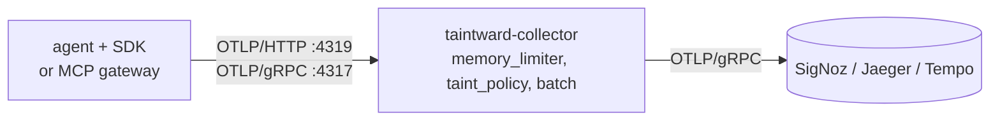

# Policy collector

The Taintward collector is an OpenTelemetry Collector build with one extra
processor, `taint_policy`. Put it between your agents and your trace backend.
On every span it:

1. reads the `taintward.*` attributes the SDK or gateway set,
2. evaluates the Rego policy (`collector/policy/pii_egress.rego`),
3. writes the authoritative `taintward.policy.*` attributes,
4. masks raw PII and secrets that are still anywhere on the span (attributes,
   span name, status message, events, links), whatever the policy said,

and then passes the span on. Raw values never reach the backend's storage.



You need it when:

- several services or languages send spans and you want one policy for all
  of them;
- you want spans from code that does not use the SDK (or uses an old
  version) to be checked and masked before storage;
- you want the collector's decision in the evidence report
  (`decided_by: collector`).

## Run it

With Docker, from the repo root:

```bash
docker build -f collector/Dockerfile -t taintward-collector .
docker run --rm -p 4319:4319 -p 4317:4317 -p 13133:13133 \
  -e OTLP_EXPORT_ENDPOINT=my-backend:4317 \
  taintward-collector
```

The quickstart's `docker-compose.yml` does the same with Jaeger as the
backend. On Kubernetes use the Helm chart: [Kubernetes and Helm](../deploy-kubernetes.md).

Ports:

| port | what |
|---|---|
| 4319 | OTLP/HTTP receiver (`/v1/traces`) |
| 4317 | OTLP/gRPC receiver |
| 13133 | health check, `GET /` returns 200 |

## Settings

The image's config is `collector/config.docker.yaml`. It reads these
environment variables:

| variable | default | meaning |
|---|---|---|
| `OTLP_EXPORT_ENDPOINT` | `jaeger:4317` (set in the image) | backend as an OTLP gRPC `host:port`, plain text |
| `TAINTWARD_TRACE_EXPORTERS` | `[otlp_grpc/backend, debug]` | exporters of the traces pipeline, a YAML list; add `file` to also write OTLP JSON lines |
| `TAINTWARD_FILE_EXPORT_PATH` | `/var/lib/taintward/spans.jsonl` | where the `file` exporter writes (rotated at 100 MB, 5 old files kept) |
| `TAINTWARD_MEMORY_LIMIT_MIB` | `400` | `memory_limiter` hard limit; keep it about 80% of the container memory limit |

`taint_policy` processor options (in the collector YAML):

| option | default | meaning |
|---|---|---|
| `policy_path` | empty: the policy built into the binary | load the Rego file from disk at startup; restart to reload |
| `decision_cache_size` | `4096` | number of distinct policy inputs whose decision is cached; `0` evaluates Rego on every span (only needed for a policy that is not a pure function of its input) |
| `drop_attributes` | Google ADK's `gcp.vertex.agent.llm_request`, `llm_response`, `tool_call_args`, `tool_response` and `data` | span attributes removed before export; a name ending in `*` is a prefix. A list you set replaces the default; `[]` keeps everything. The span gets `taintward.policy.dropped_attributes` with the count. ADK writes those attributes after Taintward restored the placeholders, so they hold real values |

Keep `taint_policy` before `batch` in the pipeline. To use TLS to the
backend, or an OTLP/HTTP backend, edit the `exporters` section of a copy of
the config and mount it at `/etc/taintward/config.yaml`.

## Change the policy

Mount your file over `/etc/taintward/policy/pii_egress.rego` and restart the
container. No rebuild. The processor checks at startup that the file is
`package taintward`, defines `decision` and `default redact := false`, and
runs two sample inputs through it; a broken policy stops the collector from
starting. Rules are explained in [Policy](../concepts/policy.md).

## SDK settings when a collector is present

By default the SDK masks tool input and output on spans in the process. That
is the safe choice and you can keep it with a collector.

If the collector runs as a sidecar on the same host (traffic never crosses
a network you do not trust) and you want the collector to mask tool inputs,
set `TAINTWARD_MASK_IN_SDK=0` in the agent. The SDK then sends tool inputs
to the sidecar unmasked, and the sidecar masks them before export. Tool
outputs are still masked in the process: the collector only knows regex
types, so names, addresses and IBANs in an output would pass it. Do not do
this when the collector is reached over a shared network.

The SDK marks redacted tool arguments with `taintward.args_redacted=true`.
The collector keeps those arguments as they are (so reversible tokens on
internal spans survive) and masks everything else.

## Two tier layout

With several collector pods, a small routing tier can send all spans of one
trace to the same policy pod (`load_balancing` exporter, `routing_key:
traceID`). The config outside Kubernetes is `collector/config.gateway-tier.yaml`,
which reads `TAINTWARD_POLICY_TIER_HOST` (a DNS name that resolves to every
policy pod), `TAINTWARD_POLICY_TIER_PORT` (default `4317`) and
`TAINTWARD_MEMORY_LIMIT_MIB`. In Helm it is `routingTier.enabled=true`.
Sizing: [Scaling](../scaling.md).

## Build it yourself

The binary is built with the OpenTelemetry Collector Builder from
`collector/builder.yaml` (collector core and contrib v0.160.0). The Go code
of the processor is in `collector/processor/taintpolicy/`; run its tests
with:

```bash
cd collector/processor/taintpolicy && go test ./...
```
