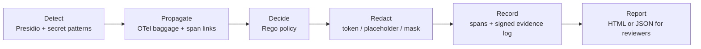

# Taintward

Taintward finds sensitive data (SSNs, emails, API keys, names) in the tool
calls of AI agents, tracks it through the call chain with OpenTelemetry
baggage, and redacts it for each destination before it leaves:

- internal systems get a reversible FF1 token (`234-12-1234` becomes
  `103-48-0677`),
- the LLM gets a placeholder (`<SSN_1>`, `<PERSON_1>`) and your code gets the
  real value back in the reply,
- external APIs and logs get a one-way mask (`[PII]`, `[SECRET]`).

Every decision is written to the span, checked again by a Rego policy in an
OpenTelemetry collector, and can be recorded in a signed, tamper-evident
evidence log. A report command turns the spans into a document you can give
to a customer's security team.

Taintward is open source (Apache-2.0) and runs on infrastructure you may
already have: any OpenTelemetry backend (SigNoz, Jaeger, Grafana Tempo).
There is no LLM in the decision path.

## Who it is for

- **Teams shipping an AI agent that touches customer data**, who need to
  stop that data from reaching an LLM provider, a third party API or a log
  in raw form.
- **Platform and security engineers** who want one policy for many agents,
  enforced in a collector or an MCP gateway, without changing agent code.
- **Anyone answering a security questionnaire** ("do you send our data to
  LLM providers?") who needs numbers and verifiable records, not a promise.

It is not a general DLP product, a network proxy, or a replacement for
access control. It sees the data that passes through the tools and model
calls it wraps, and nothing else. The limits are listed on each guide page.

## Three ways in

-   **Python SDK, a few lines of code**

    ---

    Wrap your LangChain or LangGraph tools, your chat model, OpenAI Agents
    SDK tools, or a plain OpenAI or Anthropic client. One `init()` call
    with a map of tool names to destinations.

    [SDK integrations](integrations.md)

-   **MCP gateway, no code changes**

    ---

    Put `taintward-gateway` in your MCP client config in place of the real
    server. Every tool call is scanned and, per tool, redacted, blocked or
    only recorded.

    [MCP gateway](mcp-gateway.md)

-   **Policy collector, for every service**

    ---

    An OpenTelemetry collector with the `taint_policy` processor. It runs
    the Rego policy on every span, marks violations and removes raw values
    before spans reach storage.

    [Policy collector](guides/collector.md)

Most teams use the SDK or the gateway in each agent and the collector in
front of their trace backend.

## How it works

1. **Detect.** Each tool input and output is scanned for PII and secrets.
2. **Propagate.** Once a call in a run touches sensitive data, a small tag
   (`taint.id`, `taint.classes`, never the value) rides in OTel baggage to
   every later call in the run. The tag survives an LLM that rewrites the
   data beyond recognition.
3. **Decide.** The policy says: sensitive data plus a destination of
   `external`, `llm` or `log` is a violation. PII to a non-adequate
   jurisdiction is a transfer violation (GDPR Art. 44).
4. **Redact.** The value is replaced according to the destination before
   the call is made.
5. **Record.** The span carries the decision. Violations can be appended to
   a Merkle log with Ed25519 signed checkpoints.
6. **Report.** `taintward-report` reads the spans for a time window and
   writes the evidence report.

The concepts are explained in [Concepts](concepts/destinations.md).

## Where to go next

| I want to | read |
|---|---|
| see it work in 5 minutes | [Quickstart](quickstart.md) |
| protect my LangGraph agent | [Protect a LangGraph support bot](recipes/langgraph-support-bot.md) |
| protect an MCP server | [Gateway in front of a GitHub MCP server](recipes/github-mcp-gateway.md) |
| try it without risk in production | [Audit mode first, then enforce](recipes/audit-then-enforce.md) |
| answer a customer security review | [Monthly report](recipes/monthly-report.md) |
| look up a setting | [Configuration](reference/configuration.md) |
| know what is stable | [Stability and versioning](operations/versioning.md) |
| report a security bug | [Reporting a vulnerability](security.md) |
