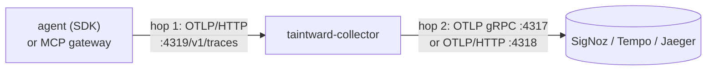

# Send traces to SigNoz, Grafana Tempo or Jaeger

**Goal:** get Taintward spans into the trace backend you already run, with
the policy collector in between so raw values never reach the backend's
storage.

Taintward speaks plain OTLP, so any OTLP backend works. There are two hops
to configure:



## Hop 1: agent to collector

The SDK and the gateway export OTLP/HTTP.

| sender | setting |
|---|---|
| SDK | `tw.init("my-agent", endpoint="http://<collector>:4319/v1/traces")` (default without `endpoint`: `http://localhost:4318/v1/traces`) |
| SDK, low level | `taintward.sdk.instrumentation.configure_tracing("my-agent", endpoint=...)` |
| MCP gateway | `--otlp-endpoint http://<collector>:4319/v1/traces` or `TAINTWARD_OTLP_ENDPOINT`; no spans are exported when neither is set |
| your app already set up OpenTelemetry | `tw.init("my-agent", tracer=trace.get_tracer("my-agent"))` uses your provider and exporter; point that exporter at the collector |

The collector also accepts OTLP gRPC on port 4317, for other services.

You can skip the collector and point the SDK straight at the backend's OTLP
port. The SDK masks spans in the process by default, so raw values still do
not reach the backend, but you lose the collector's policy attributes
(`taintward.policy.*`), its second masking pass, and `decided_by: collector`
in the report. Use the collector for anything beyond a test.

## Hop 2: collector to backend

The collector image sends OTLP gRPC to `OTLP_EXPORT_ENDPOINT` (`host:port`,
plain text). The Helm chart uses `exporter.protocol`, `exporter.endpoint`,
`exporter.insecure` and `exporter.headers`.

### SigNoz (self-hosted)

| run as | setting |
|---|---|
| Docker, SigNoz on the same host | `OTLP_EXPORT_ENDPOINT=host.docker.internal:4317` |
| Docker, SigNoz elsewhere | `OTLP_EXPORT_ENDPOINT=signoz.example.internal:4317` |
| Helm, SigNoz chart in `platform` | the default: `exporter.endpoint=signoz-otel-collector.platform.svc.cluster.local:4317` |

Find the spans: Traces, filter `service.name = <your service>` and
`taintward.policy.violation = true`. The SigNoz dashboards in `dashboards/`
(lineage, blast radius, SLO) read the same attributes; import the
JSON files in SigNoz under Dashboards, New dashboard, Import JSON.

### SigNoz Cloud

TLS and an ingestion key are needed, so use Helm values (or your own
collector config, see below):

```yaml
exporter:
  protocol: grpc
  endpoint: ingest.<region>.signoz.cloud:443
  insecure: false
  headers:
    signoz-ingestion-key: ${env:SIGNOZ_INGESTION_KEY}
collector:
  extraEnv:
    - name: SIGNOZ_INGESTION_KEY
      valueFrom:
        secretKeyRef: {name: signoz-cloud, key: ingestion-key}
```

The same file is `deploy/helm/taintward/examples/values-signoz.yaml`.

### Grafana Tempo

Tempo must have its OTLP receiver on (`distributor.receivers.otlp.protocols.grpc`
in the Tempo config). Then:

| run as | setting |
|---|---|
| Docker | `OTLP_EXPORT_ENDPOINT=tempo:4317` |
| Helm | `exporter.endpoint=tempo.<namespace>.svc:4317` (with the `tempo-distributed` chart: the distributor service) |
| Grafana Cloud | OTLP/HTTP with basic auth, see "Backends that need TLS or headers" below |

Find the spans in Grafana, Explore, data source Tempo, with TraceQL:

```text
{ span.taintward.policy.violation = true }
{ resource.service.name = "support-bot" && span.taintward.destination = "llm" }
```

### Jaeger

| run as | setting |
|---|---|
| Docker (the quickstart) | `OTLP_EXPORT_ENDPOINT=jaeger:4317` (the default) |
| Helm | `exporter.endpoint=jaeger-collector.<namespace>.svc:4317` |

Find the spans: Search, pick the service, Tags `taintward.policy.violation=true`.
Jaeger is also a report source: `taintward-report --source jaeger`.

## Backends that need TLS or headers

The Docker image's config sends plain gRPC. For TLS, auth headers or
OTLP/HTTP, copy `collector/config.docker.yaml`, change the exporter and mount
the copy over `/etc/taintward/config.yaml`. Example for an OTLP/HTTP backend
with basic auth (Grafana Cloud style):

```yaml
exporters:
  otlp_http/backend:
    endpoint: https://otlp-gateway-<zone>.grafana.net/otlp
    headers:
      Authorization: "Basic ${env:OTLP_BASIC_AUTH}"
service:
  pipelines:
    traces:
      receivers: [otlp]
      processors: [memory_limiter, taint_policy, batch]
      exporters: [otlp_http/backend]
```

```bash
docker run --rm -p 4319:4319 \
  -e OTLP_BASIC_AUTH="$(printf '%s:%s' "$INSTANCE_ID" "$TOKEN" | base64 -w0)" \
  -v "$PWD/my-collector.yaml:/etc/taintward/config.yaml:ro" \
  taintward-collector
```

With Helm: `exporter.protocol=http`, `exporter.endpoint=https://...`,
`exporter.insecure=false` and `exporter.headers`.

Keep `taint_policy` before `batch` in any config you write.

## Keep a copy for reports

Whatever the backend, you can also write every checked span to OTLP JSON
files, which `taintward-report --source otlp-file` reads without any backend:

- Docker: `TAINTWARD_TRACE_EXPORTERS='[otlp_grpc/backend, file]'`
- Helm: `collector.fileExport.enabled=true`

## Check it

Send the demo through your setup and look for the three violations
(`ask_llm`, `call_external_api`, `write_log`):

```bash
docker compose run --rm -e COLLECTOR_ENDPOINT=http://<collector>:4319/v1/traces demo
```

Then search your backend for the fake SSN `234-12-1234`. It must not be
found.
