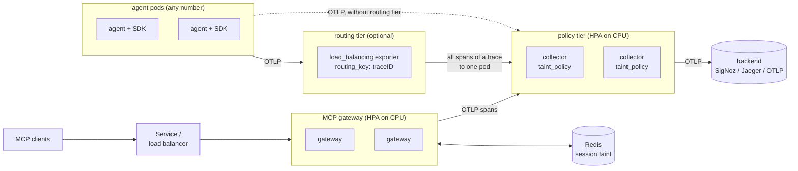

# Scaling Taintward

This page explains how Taintward is laid out when it has to handle many
agents, what one pod can do (measured), and how to size a deployment. The
install steps are in [deploy-kubernetes.md](deploy-kubernetes.md).

## The layout



There are three parts:

1. **The SDK in each agent.** It detects sensitive data, tags the call chain
   and masks values before they leave the process. It scales with the
   agents themselves: every agent process does its own detection.
2. **The collector tier.** Agents send spans here. The `taint_policy`
   processor runs the Rego policy on each span, writes the
   `taintward.policy.*` attributes and removes any raw PII or secret that is
   still in the span. Then the spans go to the backend. The pods hold no
   state, so the HPA can add and remove them freely.
   * With one policy pod, or when you do not care which pod sees which span,
     agents send straight to the policy Service.
   * With the **routing tier** on, agents send to a small collector that uses
     the `load_balancing` exporter with `routing_key: traceID`. Every span of
     one agent run then reaches the same policy pod. It finds the policy
     pods through a headless Service and re-reads it every 5 seconds, so new
     pods get traffic quickly. When a pod goes away, the routing tier retries
     the data on the remaining pods (this was tested during a rollout: no
     span was lost).
3. **The MCP gateway.** For agents that use MCP tools, the gateway sits
   between the MCP client and the MCP servers. Run several replicas behind
   the Kubernetes Service (or any load balancer). The session taint lives in
   a shared Redis (`session_store: redis://...`), so any replica can answer
   any request of a session; no sticky sessions are needed.

The backend (SigNoz, Jaeger, ...) scales on its own and is not covered here.

## Measured numbers

All numbers come from the scripts in `loadtest/` on one laptop (12th Gen
Intel Core i5-1235U, 12 logical CPUs, 15 GB RAM) while other work was
running, so they are rough. Re-run them on your own hardware; each script
prints a table and writes it to `loadtest/results/`.

### Collector (`loadtest/collector/run.sh`)

Spans per second per CPU core, through memory_limiter, taint_policy and batch:

| spans | spans/s per core |
|---|---:|
| every span is a violation (sensitive data to an external sink, gets redacted) | about 4,000 |
| clean spans (Rego runs, nothing to redact) | about 17,000 |
| no taint_policy at all (baseline) | about 60,000 |

Throughput grew with cores up to the 4 CPUs tested, at the same rate per
core. Details: [loadtest/results/collector.md](../loadtest/results/collector.md).

### SDK (`loadtest/sdk_throughput.py`)

Wrapped tool calls per second in one agent process (spans go to an
in memory exporter, so no network time):

| payload | 1 thread | 2 threads | 4 threads | 8 threads | 2 processes | 4 processes |
|---|---:|---:|---:|---:|---:|---:|
| clean (no sensitive data) | 40 | 35 | 23 | 21 | 38 | 66 |
| leak (SSN, email, AWS key) | 20 | 18 | 13 | 11 | 25 | 36 |

Details: [loadtest/results/sdk-current.md](../loadtest/results/sdk-current.md).

Detection (Presidio and spaCy) is about 25 to 50 ms per call and is pure
Python, so more **threads do not help** (the GIL), and they even slow down a
little. More **processes** do help.

These SDK and gateway numbers were measured before the fast detection path
landed (see [benchmark.md](benchmark.md): a 1 KB wrapped call went from
518 ms to 8.4 ms p50), so they are lower than what 0.2.0 does. Re-run the
scripts to get numbers for the current code and your hardware:

```bash
.venv/bin/python loadtest/sdk_throughput.py --label after-change
```

### MCP gateway (`loadtest/gateway_throughput.py`)

Tool calls per second through the gateway in front of the example HR MCP
server (`list_departments` is clean, `get_employee` returns an SSN and an
AWS key that the gateway masks):

| transport | gateway processes | concurrent clients | clean calls/s | sensitive calls/s |
|---|---:|---:|---:|---:|
| stdio | 1 | 1 session | 22 | 28 |
| HTTP | 1 | 1 | 25 | 26 |
| HTTP | 1 | 8 | 17 | 21 |
| HTTP | 2 | 4 | 34 | 39 |
| HTTP | 4 | 4 | 44 | 44 |
| HTTP | 4 | 8 | 40 | 40 |

One gateway process does about 20 to 28 calls/s, the same over stdio and
HTTP: the time goes into scanning arguments and results, not the
transport. More clients on one process do not add throughput. More
processes (replicas) do, but less than linearly here because the load
generator (one Python process), the gateways and their upstream servers all
shared one laptop that was busy with other work. With pods on their own cores, plan for
about 20 calls/s per replica. Details:
[loadtest/results/gateway-current.md](../loadtest/results/gateway-current.md).

## How to size a deployment

Start from the number of spans per second your agents send. Count every
tool call, LLM call and agent step as one span (most agents send 5 to 20
spans per run).

**Collector tier.** Plan for about 4,000 spans/s per core if you expect
most spans to carry sensitive data, and about 10,000 for a normal mix. Then
add room for peaks:

```
cores = peak spans/s / 4,000   (worst case)
pods  = cores / CPU limit per pod, at least 2
```

Example: 200 agents, each running one task per 10 seconds with 10 spans per
task, is 200 spans/s. That is far below one core, so the default 2 pods
(for availability) are enough. 20,000 spans/s worst case needs about 5
cores, so 5 pods with 1 CPU each, or 3 with 2 CPUs; set the HPA maximum
above that.

The defaults (`requests.cpu: 500m`, `limits.cpu: 2`, HPA target 70%) scale a
pod out when it averages more than 350m CPU, which is about 1,400 worst case
spans/s per pod. Raise `requests.cpu` if you would rather run fewer, bigger
pods. Memory stays low (the policy keeps no state); 256Mi to 512Mi per pod
is plenty, and `memory_limiter` refuses data (the SDK retries) before the
pod would run out of memory.

**Routing tier.** It only forwards, which is much cheaper than the policy
work. One routing pod per 4 to 8 policy pods is a safe start, or a DaemonSet
with one per node.

**Gateway.** Size it by tool calls per second, not spans:

```
pods = peak tool calls/s / 20   (calls per pod per second, measured above)
```

Give each pod about 1 CPU and 1 GiB of memory (Presidio and spaCy are
loaded in every process, about 300 MB). Use Redis for sessions as soon as
there is more than one replica.

## Limits

* **SDK detection is the slowest step.** Tens of milliseconds per tool call
  on a laptop core, and threads do not add throughput. This is the number to
  watch for tool heavy agents.
* **Gateway throughput per pod is limited by detection too**, and the gateway
  is one Python process per pod. Scale it out with replicas, not threads.
* **The collector's redaction regexes** cost about 4 times as much as the
  Rego decision itself. Fine at the numbers above, but it is the first thing
  to optimize in the Go processor if needed.
* **One sender is serial.** One OTLP exporter keeps one request in flight.
  A single very busy agent process is limited by its own exporter, not by
  the collector tier.
* **Policy changes restart the collector pods** (rolling, with the PDB
  keeping at least one up). Senders retry, and the routing tier re-routes,
  but expect a short bump in latency.
* **The routing tier can drop data** if every policy pod is down for longer
  than its retry window (2 minutes) or its queue (5,000 batches) fills.
* **Detection fails open.** If Presidio or spaCy cannot load, `taintward/sdk/detect.py`
  finds nothing, and the collector only redacts spans marked sensitive. The
  gateway image checks detection at build time for this reason (see
  [loadtest/results/kind-verification.md](../loadtest/results/kind-verification.md)).
* **The file exporter writes per pod.** With several pods you get several
  files; use a backend for anything you need in one place.
* **The image is about 85 MB.** The `load_balancing` exporter brings in the
  Kubernetes and AWS resolver clients (about 35 MB of it).
* The load tests ran on one laptop with the load generator on the same
  machine, so absolute numbers on server hardware will be higher.
